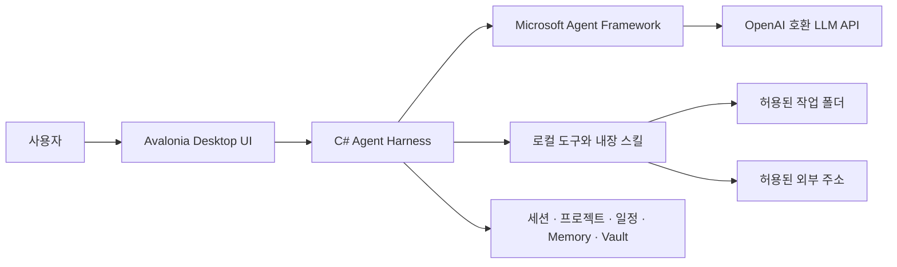

<p align="center">
  
</p>

<h1 align="center">silaa</h1>

<p align="center">
  <strong>누구나 대화하듯 사용할 수 있는 Windows용 로컬 AI 에이전트 워크스페이스</strong>
</p>

<p align="center">
  Microsoft Agent Framework와 OpenAI 호환 API를 기반으로 대화, 프로젝트, 일정, 자동화와 로컬 도구를 하나의 데스크톱 앱에 담습니다.
</p>

<p align="center">
  <a href="https://github.com/TRIPLESONG90/silaa/releases/tag/v0.9.0-preview.10"></a>
  <a href="https://github.com/TRIPLESONG90/silaa/releases"></a>
  
  
  
  
</p>

<p align="center">
  <a href="#다운로드">다운로드</a> ·
  <a href="#주요-기능">주요 기능</a> ·
  <a href="#빠른-시작">빠른 시작</a> ·
  <a href="#아키텍처">아키텍처</a> ·
  <a href="#보안과-데이터">보안과 데이터</a> ·
  <a href="#기여하기">기여하기</a>
</p>

> [!IMPORTANT]
> silaa는 현재 공개 프리뷰입니다. 중요한 작업에는 결과를 직접 검토하고, 명령 실행과 외부 주소 접근 권한을 신중하게 승인해 주세요.

## silaa란?

silaa는 코딩 하네스의 강력한 로컬 도구 사용 능력을 일반 사용자도 챗봇처럼 사용할 수 있게 만드는 오픈소스 데스크톱 프로젝트입니다. 별도의 OpenCode CLI나 JavaScript 런타임, 로컬 HTTP 에이전트 서버를 실행하지 않고 C# 네이티브 하네스가 Microsoft Agent Framework의 에이전트 실행 주기를 직접 관리합니다.

- **대화에서 실행까지** — 질문, 파일 분석, 코드 작성, 명령 실행과 결과 확인이 한 흐름으로 이어집니다.
- **업무를 프로젝트로** — 대화가 구체화되면 프로젝트, 자료, 메모리, 스킬과 산출물을 함께 관리합니다.
- **로컬 우선** — 세션과 설정은 PC에 저장하고, 파일·명령·네트워크 접근은 명시적인 허용 경계 안에서 수행합니다.
- **모델 선택권** — NVIDIA NIM, Ollama 등 OpenAI 호환 Chat Completions API를 연결할 수 있습니다.

## 다운로드

### Windows x64 프리뷰

[**silaa 0.9.0 Preview 10 ZIP 다운로드**](https://github.com/TRIPLESONG90/silaa/releases/download/v0.9.0-preview.10/silaa-0.9.0-preview.10-win-x64.zip)

[**silaa 0.9.0 Preview 10 MSI 설치 파일**](https://github.com/TRIPLESONG90/silaa/releases/download/v0.9.0-preview.10/silaa-0.9.0-preview.10-win-x64.msi)

1. ZIP 파일을 내려받아 원하는 폴더에 압축을 풉니다.
2. `silaa.exe`를 실행합니다.
3. **설정 → LLM 연결**에서 OpenAI 호환 API 주소, 모델과 API 키를 등록합니다.

자체 포함형 단일 파일 빌드라 별도의 .NET 런타임 설치가 필요하지 않습니다. MSI는 Windows 전체 사용자용으로 설치되므로 관리자 승인을 요청할 수 있습니다. 현재 실행 파일은 코드 서명이 없는 프리뷰이므로 Windows SmartScreen 경고가 표시될 수 있습니다. 배포 파일과 SHA-256 체크섬은 [Release 페이지](https://github.com/TRIPLESONG90/silaa/releases/tag/v0.9.0-preview.10)에서 함께 제공합니다.

## 주요 기능

### 대화와 에이전트

- 세션별 병렬 응답과 응답 중인 세션 표시
- 추론 → 도구 호출 → 추론 순서를 유지하는 실시간 타임라인과 블록별 복사
- 누적 추론 중복 제거와 동일 도구 반복 루프 안전 중단
- 첫 응답 이벤트를 기다리는 동안 표시되는 가벼운 스피너
- 사용자 선택·확인·추가 정보가 필요할 때 사용하는 네이티브 인터랙션 카드
- Markdown, 표, 코드, 차트 렌더링과 대화 전체 복사
- 응답별 사용 모델 기록과 연결별 추론 단계 선택
- Microsoft Agent Framework `AIAgent` 기반 스트리밍·함수 호출·실행 수명 주기

### 프로젝트와 지식

- 대화형 설문으로 막연한 아이디어를 실행 가능한 프로젝트 정보로 구체화
- 프로젝트별 세션, 파일, 웹 주소, 코드와 비정형 자료 관리
- 프로젝트 개요와 앱 실행 상태·주소를 관리하는 전용 화면
- 전체·프로젝트·세션 범위의 폴더 접근 권한
- 프로젝트 Memory와 DPAPI로 보호되는 Vault
- Claude Code·Codex 형식의 `SKILL.md` 검색, 웹 가이드 지침 등록과 로딩

### 일정과 자동화

- 약속·행사·마감 등을 기록하는 실제 캘린더
- 일반 대화 안에서도 확인 카드를 거쳐 일정을 바로 저장
- 사용자가 원할 때만 일정 알람이나 준비 작업 추가
- 백그라운드 작업, 반복 cron 작업과 Windows 완료 알림
- 창을 닫아도 시스템 트레이에서 작업 지속
- 로컬·UTC 시각과 시간대를 구조화해 제공하는 `get_current_datetime` 도구

### 문서와 시각화

- PDF, DOCX, PPTX, XLSX 등 문서 읽기·쓰기용 스킬
- 파일 드래그 앤 드롭과 바이너리 메타데이터 검사
- 문서 디자인 템플릿의 대화형 편집과 실시간 미리보기
- 인터넷 연결 없이 HTML/SVG로 렌더링하는 bar, line, donut 차트
- 코드 근거 기반 Mermaid 뷰를 만드는 `architecture-diagram` 내장 스킬

### 로컬 도구

- 파일 목록, 읽기, 검색, 쓰기와 정확 치환
- 명령 실행과 백그라운드 프로세스 관리
- 설정에서 켜고 끌 수 있는 GitHub Release 자동 업데이트와 SHA-256 패키지 검증
- 허용 주소 기반 웹 검색과 페이지 조회
- 앱 내부 브라우저와 로컬 산출물 미리보기

## 빠른 시작

### 1. LLM 연결

**설정 → LLM 연결 → 연결 추가**에서 아래 정보를 입력합니다.

| 항목 | 설명 |
|---|---|
| API 주소 | OpenAI 호환 API의 기본 주소. `/chat/completions`는 제외 |
| 모델 ID | 공급자가 제공하는 모델 이름 |
| API 키 | 선택 사항. Windows DPAPI(CurrentUser)로 암호화 저장 |
| 최대 출력 토큰 | 비워 두면 공급자 기본값 사용 |
| 컨텍스트 길이 | 오래된 대화와 도구 기록을 정리하는 기준 |
| 추론 단계 | 공급자가 지원하면 `reasoning_effort`로 전달 |
| Temperature / Top P | 비워 두면 공급자 기본값 사용 |
| 요청 제한 시간 | 비워 두면 120초 |

예시:

- NVIDIA NIM: `https://integrate.api.nvidia.com/v1`
- Ollama: `http://127.0.0.1:11434/v1`

공급자마다 OpenAI 호환 범위가 다를 수 있습니다. 지원하지 않는 옵션은 연결 설정에서 비워 두는 것이 가장 안전합니다.

### 2. 대화 시작

홈에서 **새로운 대화**, **새로운 프로젝트**, **새로운 작업/일정** 중 하나를 선택합니다. 일반 대화는 대화 목록에 남고, 프로젝트 생성 설문은 프로젝트가 만들어진 뒤 해당 프로젝트의 첫 세션으로 보존됩니다.

### 3. 권한 승인

에이전트가 새로운 폴더나 외부 주소에 접근해야 하면 승인 카드를 표시합니다. 승인 범위와 대상을 확인한 뒤 허용해 주세요.

## 아키텍처



| 계층 | 기술과 역할 |
|---|---|
| Desktop UI | Avalonia 12, AXAML, CommunityToolkit.Mvvm |
| Agent runtime | Microsoft Agent Framework, C# 네이티브 도구 호출 |
| LLM transport | OpenAI 호환 `/chat/completions` 스트리밍 |
| Persistence | 로컬 JSON 저장소와 Windows DPAPI |
| Skills | 저장소, 사용자, 프로젝트 범위의 Markdown 기반 `SKILL.md` |

## 보안과 데이터

- API 키와 Vault 값은 Windows DPAPI(CurrentUser)로 암호화합니다.
- 세션, 프로젝트, 일정과 작업 정보는 기본적으로 `%LOCALAPPDATA%\silaa`에 저장합니다.
- 에이전트의 파일 접근은 전체·프로젝트·세션별 허용 폴더로 제한합니다.
- 웹 도구는 허용된 `host:port` 경계 안에서 리디렉션을 다시 검사합니다.
- 명령 실행은 작업 폴더에서 수행하지만 운영체제 수준의 완전한 샌드박스는 아닙니다.
- 저장소와 Release에는 API 키나 개인 설정 파일을 포함하지 않습니다.

DPAPI는 같은 Windows 사용자 권한으로 실행되는 다른 프로세스까지 막는 하드웨어 보안 모듈이 아닙니다. 민감한 환경에서는 전용 사용자 계정과 최소 권한 폴더를 사용하세요.

## 소스에서 실행

### 요구 사항

- Windows 10/11 x64
- [.NET 10 SDK](https://dotnet.microsoft.com/download/dotnet/10.0)

```powershell
git clone https://github.com/TRIPLESONG90/silaa.git
cd silaa
dotnet run --project src/silaa/silaa.csproj
```

### 검증

```powershell
dotnet build src/silaa/silaa.csproj -c Release
dotnet run --project tests/silaa.Tests.csproj -c Release
dotnet run --project tests/silaa.Tests.csproj -c Release -- --xaml-smoke
```

렌더링 성능을 확인하려면 다음 진단 명령도 사용할 수 있습니다.

```powershell
dotnet run --project tests/silaa.Tests.csproj -c Release -- --render-bench
dotnet run --project tests/silaa.Tests.csproj -c Release -- --ui-latency-probe
```

### Windows 배포

```powershell
.\scripts\publish-win-x64.ps1
```

결과는 `publish\win-x64`에 생성됩니다.

## 프로젝트 상태

silaa는 빠르게 변하는 초기 프리뷰입니다. 저장 형식, 화면 구성과 일부 도구 인터페이스는 정식 버전 전에 변경될 수 있습니다.

- [Releases](https://github.com/TRIPLESONG90/silaa/releases) — 설치 가능한 빌드와 체크섬
- [Issues](https://github.com/TRIPLESONG90/silaa/issues) — 버그 제보와 기능 제안

## 기여하기

버그 재현, 문서 개선, 접근성 피드백, 공급자 호환성 테스트와 Pull Request를 환영합니다.

1. 기존 [Issue](https://github.com/TRIPLESONG90/silaa/issues)를 확인하거나 새 Issue를 작성합니다.
2. 작업 브랜치에서 변경합니다.
3. 관련 테스트를 실행합니다.
4. 변경 이유와 검증 방법을 포함해 Pull Request를 엽니다.

보안 취약점이나 비밀 정보가 포함된 문제는 공개 Issue에 원문을 올리지 말고 저장소 소유자에게 비공개로 알려 주세요.

---

<p align="center">
  <sub>Built with C#, Avalonia and Microsoft Agent Framework.</sub>
</p>
