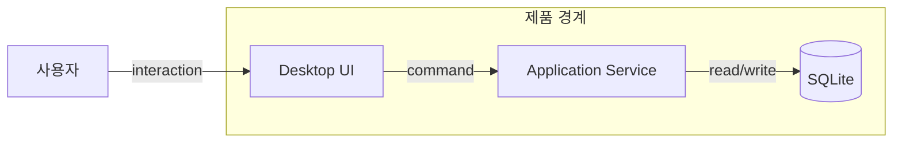
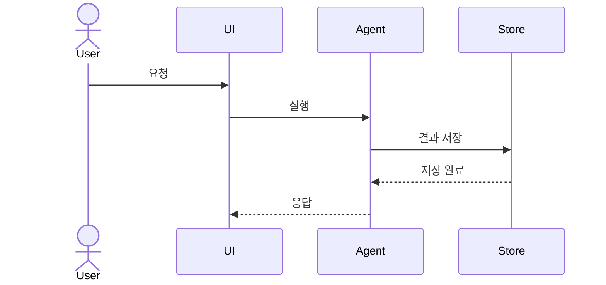

# Mermaid architecture views

Use this reference while authoring or repairing Mermaid. Choose one view per diagram.

## Structural views

- Context/container/component: use `flowchart LR` for left-to-right request or dependency flow and `flowchart TB` for hierarchy.
- Use `subgraph` for an actual system, trust, deployment, or ownership boundary—not merely visual grouping.
- Put technology details on a second label line only when they affect an architectural decision.
- Use solid arrows for implemented calls or data movement and dashed arrows for optional, asynchronous, or inferred relationships. Explain the convention in a legend.

## Sequence views

- Use `sequenceDiagram` for one concrete scenario.
- Name participants by architectural role, not variable name.
- Include error or retry branches only when relevant; prefer `alt`, `opt`, and `loop` over duplicated arrows.

## Data views

- Use `erDiagram` only for stable entities and relationships that are verified from schemas or models.
- Do not guess cardinality. If cardinality is unknown, use a flowchart data-ownership view instead.
- Avoid listing every column; include identifiers and fields relevant to the architectural question.

## Quality checks

- Node IDs contain ASCII letters, digits, or underscores; visible labels may use Korean.
- Labels that contain punctuation are quoted or placed in brackets.
- Each subgraph has a unique ID and closing `end`.
- Avoid HTML, custom scripts, remote images, and external Mermaid initialization directives.
- If a renderer rejects a valid advanced feature, simplify to basic flowchart or sequence syntax rather than relying on renderer-specific extensions.
